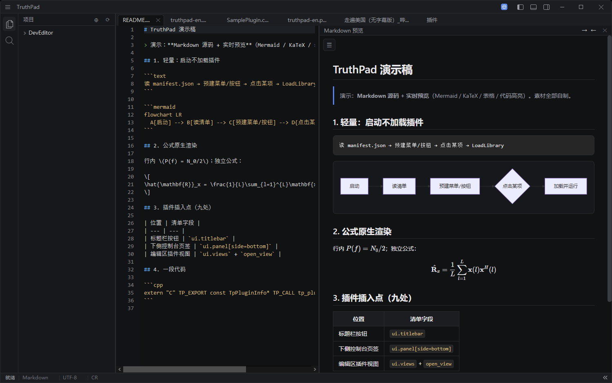
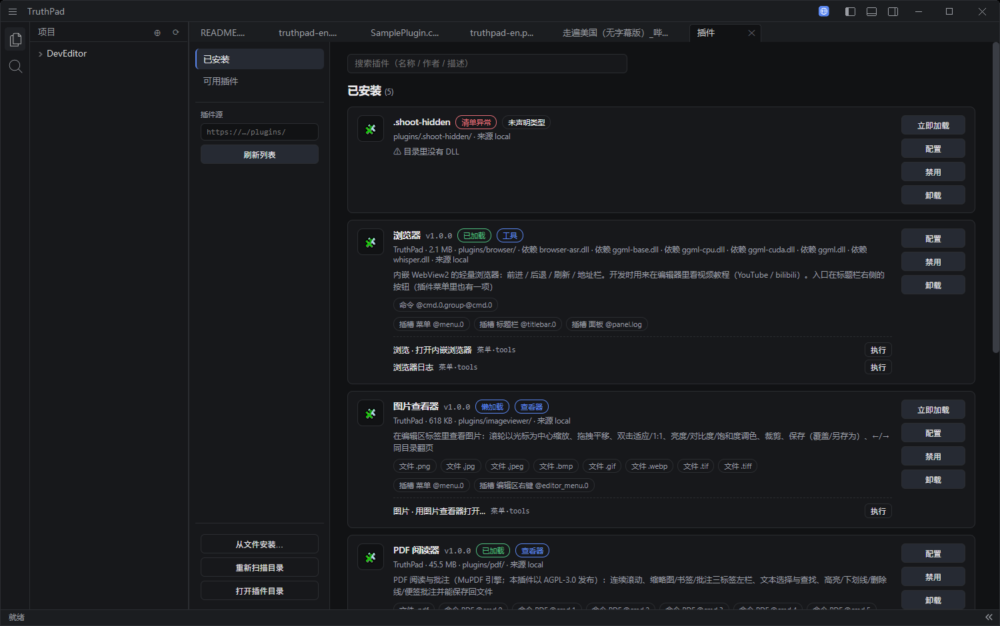
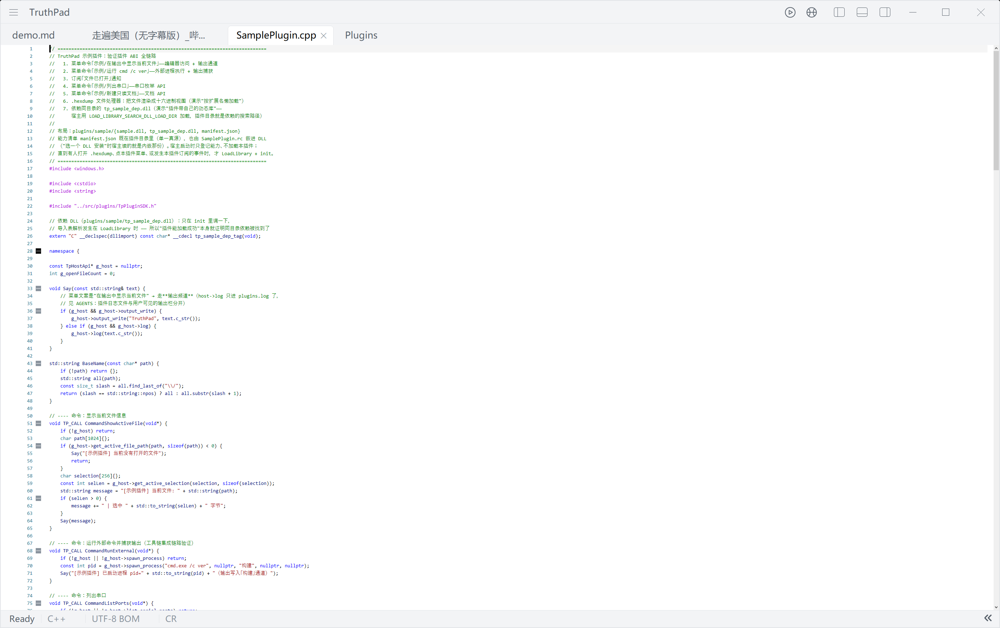
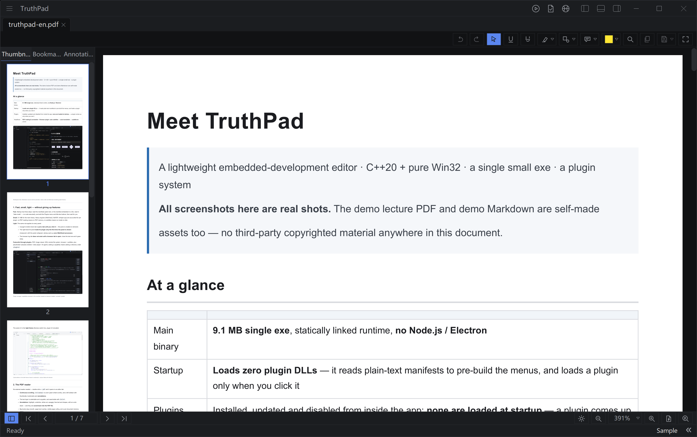
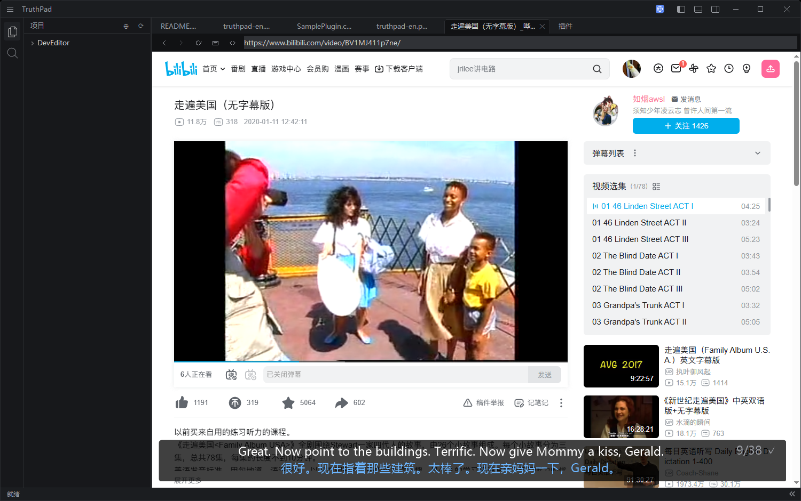
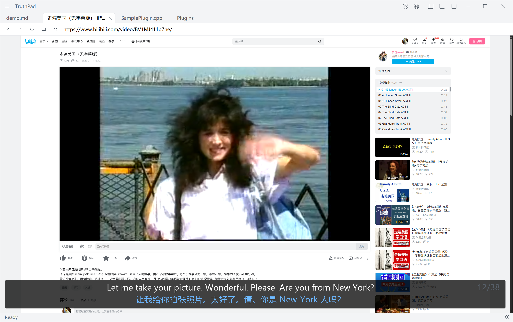

# Meet TruthPad

> A lightweight embedded-development editor · C++20 + pure Win32 · a single small exe · a plugin system
> **All screenshots here are real shots.** The demo lecture PDF and demo Markdown are self-made
> assets too — no third-party copyrighted material anywhere in this document.

## At a glance

| | |
| --- | --- |
| Main binary | **9.1 MB single exe**, statically linked runtime, **no Node.js / Electron** |
| Startup | **Loads zero plugin DLLs** — it reads plain-text manifests to pre-build the menus, and loads a plugin only when you click it |
| Plugins | Installed, updated and disabled from inside the app; **none are loaded at startup** — a plugin comes up only when you use it |
| Headliners | **PDF reading & annotation** · **Browser plugin: auto subtitles → auto translation → subtitle-to-article** |



---

## 1. Fast, small, light — without giving up features

**Fast.** Startup has three steps: read the manifests (plain text, or the manifest embedded in a DLL
read in *data mode* — no code executed), pre-build the Plugins menu and title-bar buttons, then wait
for you.

**Small.** 9.1 MB for the main binary. Heavy engines (WebView2, MuPDF, whisper.cpp) are accounted for
per plugin: no PDF reading means no PDF memory, no subtitles means no model on disk.

**Light.** The same rule applies to every panel:

- A plugin's bottom-dock tab is **just a tab until you click it** — the pane is created on demand;
- The right-hand AI panel **loads its plugin only the first time the panel is shown**
  (measured: with the panel collapsed, startup spins up **zero WebView2 processes**);
- The browser log tab **does not exist until a browser tab is open**; close the last one and it goes away.

**Featureful through plugins.** PDF, image viewer, WSL remote file system, browser + subtitles,
plus placeholder samples (netdisk / video player / AI agent): adding a capability means adding a
directory under `plugins/`.



The same UI in the **light theme** (themes switch live, plugin UI included):



---

## 2. The PDF reader

No external reader needed — double-click a `.pdf` and it opens in an editor tab:

- **Continuous scrolling**, `Ctrl+wheel` to zoom (plain wheel scrolls), and a left sidebar with
  thumbnails, bookmarks and **annotations**;
- The text layer is selectable and copyable, and searchable with `Ctrl+F`;
- **Annotations**: highlight, underline, strike-out, squiggly, free text and shapes, with an undo
  stack — and they are **saved back into the PDF file**;
- Big books stay smooth: page-level caches, visible-page culling, and a per-document memory arena
  that is returned in one block when the document closes.



---

## 3. The browser plugin: auto subtitles → auto translation → subtitle-to-article

This is the plugin that earns TruthPad its keep: **it turns a foreign-language lecture into a
long, readable article.**

### 3.1 Subtitles in one click

Open a video page in the built-in browser and press **Subtitles**:

```
site script claims the page → fetch the audio source → decode to 16 kHz mono in-page
→ 8-minute segments → local whisper transcription (CPU works; CUDA used when present)
→ subtitle overlay docks onto the page
```

- Transcription runs **on your machine** (models download in-app); the audio never leaves it;
- The overlay floats above the page (draggable/dockable) and shows the original line plus the translation;
- Very long audio (2 h+) is decoded window-by-window using the MP4 segment index, then stitched.

### 3.2 Automatic translation — or proofreading only

The whole transcript goes to DeepSeek in one call (JSON schema locked: no dropped lines, no timeline
changes). Foreign-language audio is **translated**; Chinese audio is **proofread only**
(fix recognition slips, normalise formulas, unify terminology).

### 3.3 Subtitle-to-article: a three-stage "writing" pipeline

Right-click **Generate article** and the episode becomes a long-form lecture note:

| Stage | What happens |
| --- | --- |
| **Skeleton** | Read the whole transcript → document title, a global symbol table, and sections (heading + time range + key points + formula outline) |
| **Flesh** | Each section is written in full from its own slice of the transcript, stitched to the previous section's ending |
| **Merge & verify** | Per-section review (compare against the skeleton and the transcript, de-spoken-ify, repair broken diagrams) → overview + summary → assemble as a whole |

The writing rules were distilled from **three matched pairs of (transcript, human-written model
lecture)**: a 4-level heading system, a fixed tail (course summary / self-check list / discussion
questions / lab design / appendix), paragraph templates, an expansion ratio, and concrete
spoken→written rewrites.

**Hard acceptance criteria**: math may only use `\(…\)` and `\[…\]`; any `$…$` is automatically
repaired, and the assembled document is checked again end-to-end. Measured on a 2.5-hour lecture:
**195,000 characters of lecture notes with zero formula violations.**

### 3.4 Details that keep it out of your way

- **Finished work is never redone.** If an episode's subtitles are already complete, pressing
  Subtitles just says so; if an article already exists, Generate article opens it (0 model calls);
- **Unfinished work resumes.** Subtitles continue from their coverage point (already-transcribed
  parts are never redone); articles resume from a per-section checkpoint;
- **Leaving stops the work.** Closing the tab, navigating away or switching videos stops the
  in-flight audio/ASR/translation/writing jobs immediately — and they resume when you come back;
- **Links open where they should.** `target="_blank"`, `window.open` and middle-click open a new
  browser tab; ordinary links stay in the current one;
- Panels and entries **appear only when needed**, and menus **follow the app theme**.



The same view in the **light theme**:



---

## 4. Try it

1. Install the **Beta** channel package (`TruthPad-Setup-Beta.exe` — Beta ships pdf / wsl /
   imageviewer / browser);
2. Open the built-in browser (top-right) → open a video page → press **Subtitles**
   (the first time, the settings dialog asks you to download a model and paste a DeepSeek key);
3. Right-click → **Generate article**; the file is saved into the folder selected in your workspace tree.

Demo video used for the subtitle shots (public link):
<https://www.bilibili.com/video/BV1MJ411p7ne/>

---

## 5. Assets & licensing notes

- All screenshots are genuine TruthPad screenshots (dark/light themes, Chinese/English UI);
- The demo lecture PDF and the demo Markdown are self-made content;
- The demo video is a public link, used solely to demonstrate the subtitle pipeline.
