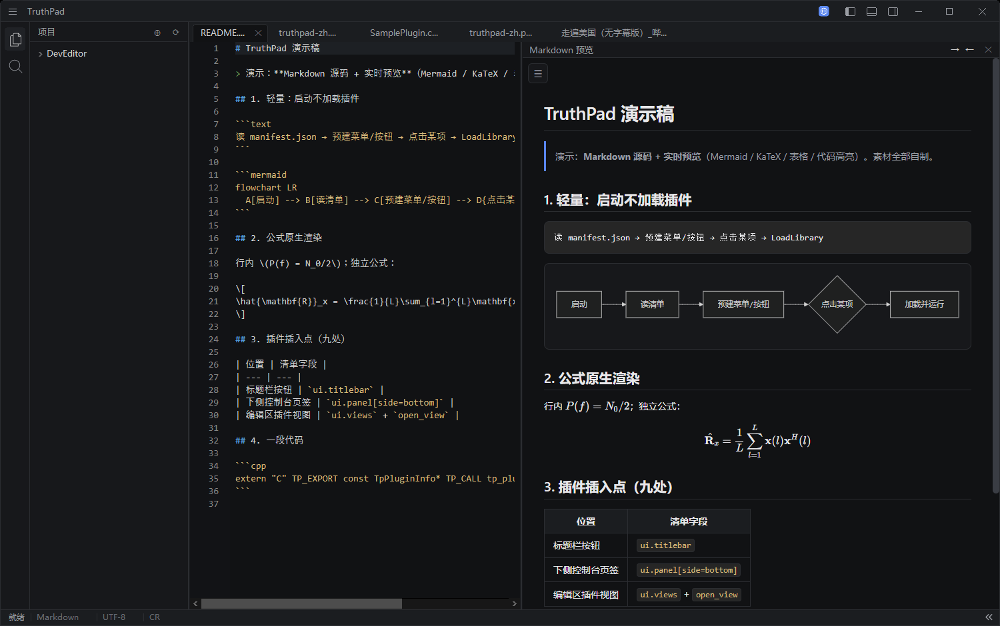
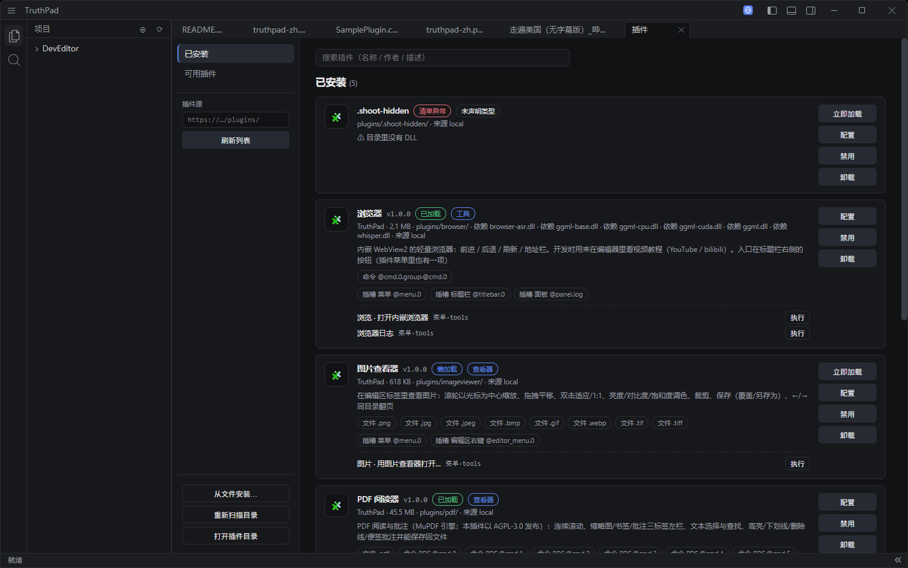
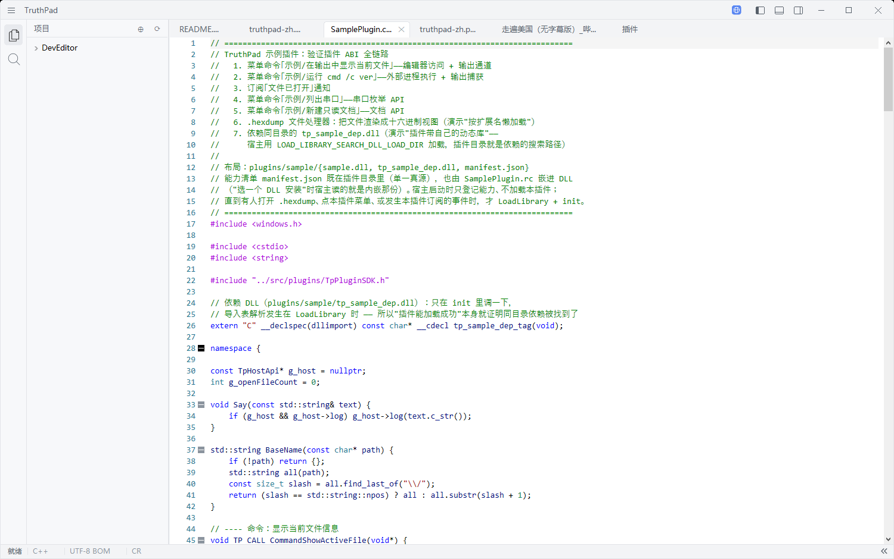
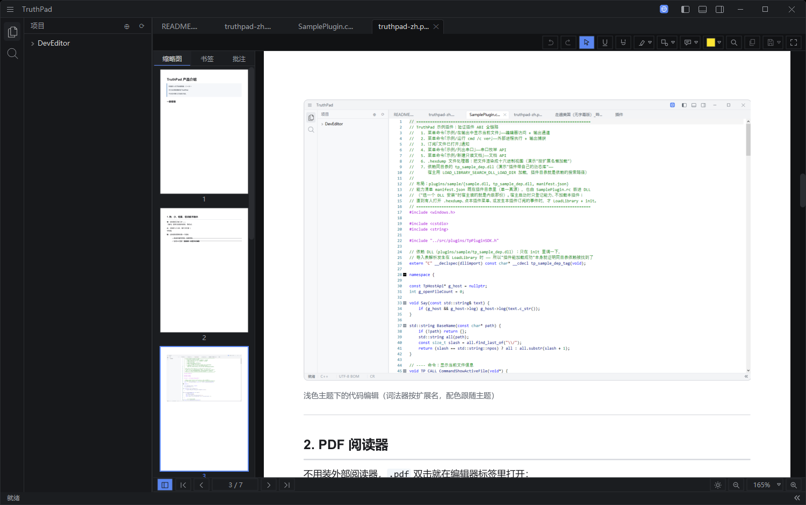
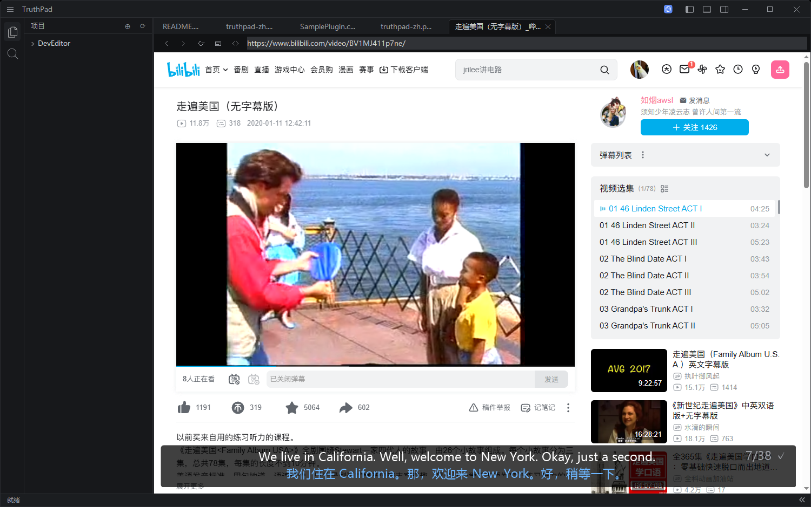
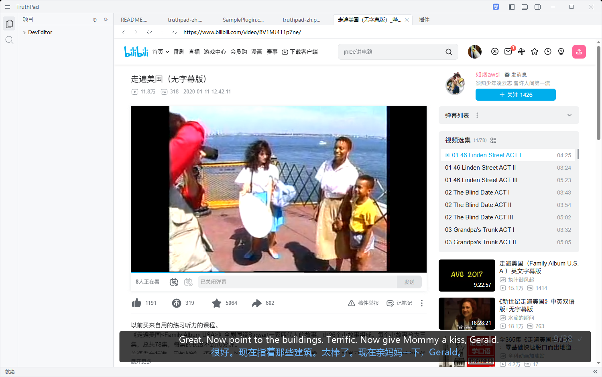

# TruthPad 产品介绍

> 轻量嵌入式开发编辑器 · C++20 + 纯 Win32 · 单 exe · 插件体系
> 本文全部配图都是 **TruthPad 自己的截图**，演示用的讲义 PDF 与 Markdown 也都是自制素材，
> 不含任何第三方版权内容。

## 一眼看懂

| 项 | 说明 |
| --- | --- |
| 主程序 | **2.5 MB 单 exe**（静态 CRT + LTCG），核心与构建链**零 Node.js** |
| 启动 | **不加载任何插件 DLL** —— 只读清单把命令预建进菜单，点到才加载 |
| 插件 | 一份 `manifest.json` 声明能力，**九处 UI 插入点**；宿主 API 从 v1 追加到 v7 都没破坏老插件 |
| 三个主打 | **PDF 阅读与批注** · **浏览器插件：自动字幕 / 自动翻译 / 字幕成文** |



---

## 1. 快、小、轻量，但功能不缩水

**快**：启动路径只有三步 —— 读清单（纯文本，或从 DLL 里以"数据模式"读内嵌清单，不执行代码）、
预建「插件」菜单与标题栏按钮、等你点。

**小**：主程序 2.5 MB，第三方引擎（Scintilla/Lexilla、WebView2、MuPDF、whisper.cpp）按插件分账，
离线可构建。

**轻**：这条原则贯穿到每一个面板 ——

- 底边栏插件页签：先摆页签，**点它才建面板**；
- 右侧 AI 面板：**面板第一次显示才装载**插件（收起状态下启动实测 **0 个 WebView2 进程**）；
- 浏览器日志页签：**浏览器没在标签里打开就不占位**，有浏览器视图才出现。

**功能丰富靠插件**：PDF、图片查看、WSL 远程文件系统、浏览器 + 字幕、网盘/视频播放/AI Agent 占位样例……
每加一种能力就是加一个目录，放进 `plugins/` 就生效。



同一套界面的**浅色主题**（主题实时切换，插件界面跟着变）：



---

## 2. PDF 阅读器

不用装外部阅读器，`.pdf` 双击就在编辑器标签里打开：

- **连续滚动** + `Ctrl+滚轮`缩放（普通滚轮是平滑滚动），左侧三标签页：缩略图 / 书签 / **批注**；
- 文本层可选中复制、可查找（`Ctrl+F`）；
- **批注**：高亮、下划线、删除线、波浪线、自由文本、图形，配**撤销栈**，并且能**保存回 PDF 文件**；
- 大书不卡：页级缓存 + 可见页裁剪 + 每文档内存域（关档整块归还）。



---

## 3. 浏览器插件：自动字幕 → 自动翻译 → 字幕成文

这是 TruthPad 最"能打"的插件：**它把一门外语课变成一篇可读的中文长文。**

### 3.1 一键得到字幕

在播放页点标题栏的浏览器按钮，再点「字幕」：

```
站点脚本认领页面 → 取音源 → 页面内解码成 16k 单声道 → 8 分钟分段
→ 本地 whisper 转写（CPU 可跑，N 卡自动走 CUDA）→ 字幕栏叠加显示
```

- 识别**在本机跑**（模型应用内一键下载），音频不出本机；
- 字幕栏浮在网页上（可拖拽/停靠），原文 + 中文两行；
- 超长音频（两小时以上）会自动按 MP4 分片表切窗口逐段解码再拼。

### 3.2 自动翻译 / 只校对

整篇字幕一次发给 DeepSeek（JSON 格式锁死，不漏条目、不动时间轴）：
外语音频就**翻译**，中文音频就**只校对**（纠识别错、公式规范化、术语统一）。

### 3.3 字幕成文（三个阶段的"写书"流水线）

右键「生成文章」，把这一集的字幕整理成一篇长讲义：

| 阶段 | 做什么 |
| --- | --- |
| **筋骨** | 通读全篇字幕 → 文档标题、全篇符号约定、各小节（标题 + 时间段 + 要点 + 公式概要） |
| **血肉** | 逐小节按时间段切字幕写全（带上一节结尾衔接） |
| **合并校验** | 逐节审校（对骨架/字幕查漏、改口语、修坏掉的图表）→ 概述 + 总结 → 总分总组装 |

写作规范是从**三组「字幕 ↔ 范文讲义」对照样本**里提炼出来的，包含：4 级标题体系、
固定尾节（课后总结 / 学习检查清单 / 思考题 / 实验设计 / 附录）、段落模板、扩写比例、
"口语 → 书面"的具体改法。

**刚性验收标准**：公式只允许 `\(…\)` 与 `\[…\]`，出现 `$…$` 一律自动返修，
组装后全篇再查一次。实测一集 2.5 小时的课程：**19.5 万字讲义、0 次公式违规**。

### 3.4 不给人添麻烦的细节

- **已完整生成过的字幕/文章不重跑**：点「字幕」只提示；点「生成文章」直接把那篇打开（0 次模型调用）；
- **没完整的接着上次位置继续**：字幕按覆盖度续转（已转好的不重做），文章按检查点续写（每节落盘）；
- **离开就停**：关标签、导航走、切到别的视频，正在跑的音频/识别/翻译/成文任务立刻停止，回来接着干；
- **该开新标签就开新标签**：`target="_blank"`、`window.open`、中键点击都开新的浏览器标签；
- 面板与入口都**按需出现**，菜单**跟随主题**（深色/浅色一致）。



同样一套界面在**浅色主题**下：



---

## 4. 怎么试

1. 安装 **Beta 渠道**包：`TruthPad-Setup-Beta.exe`（Beta = pdf / wsl / imageviewer / browser 四个插件）；
2. 打开右上角浏览器 → 打开一个视频页 → 点「字幕」（第一次会让你在设置里下识别模型、填 DeepSeek key）；
3. 字幕出来后可右键 →「生成文章」，成品会存到你工作区树里选中的那个目录。

演示视频（本手册字幕功能的那一集，公开链接）：
<https://www.bilibili.com/video/BV1MJ411p7ne/>

---

## 5. 素材与许可说明

- 所有截图均为 TruthPad 运行时截图（含深/浅主题、中文/英文界面两套）；
- 演示用讲义 PDF 与演示 Markdown 为自制内容；
- 演示视频为公开链接，仅用于演示"自动字幕/翻译/成文"这条流水线。
